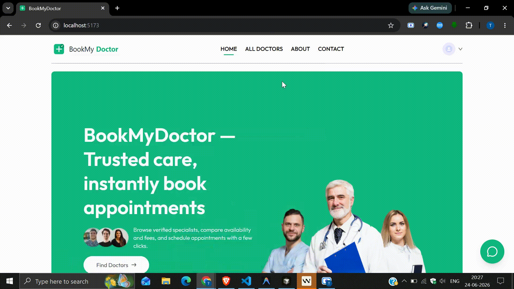

# 🩺 BookMyDoctor — Doctor Appointment Booking Platform (MERN + Agentic AI)

## 📌 Project Overview

**BookMyDoctor** is a full-stack **MERN** application that digitizes doctor appointment booking for patients, doctors, and admins. It includes a production-style **agentic AI assistant** — patients can find doctors, check availability, book appointments, and manage bookings through natural language chat.

Built as a portfolio project demonstrating **full-stack MERN development** and **agentic AI engineering** (LangGraph, tool-calling, ReAct loop).

---

## 🤖 Agentic AI Assistant

Patients interact with an AI appointment agent via a floating chat widget in the patient dashboard.

| Capability | How it works |
|------------|--------------|
| Find doctors | Agent calls `get_doctors` by speciality |
| Check availability | Agent calls `get_doctor_availability` (live data from appointments DB) |
| Book appointments | Agent calls `book_appointment` with slot-filling (doctor, date, time) |
| View / cancel | Agent calls `get_my_appointments` and `cancel_appointment` |

**Stack:** LangGraph · LangChain · Grok (xAI) · Zod tool schemas · MongoDB

**Pattern:** ReAct agent loop — LLM reasons, selects tools, observes results, repeats until done.

📖 **Full architecture:** [docs/ai-agent-architecture.md](./docs/ai-agent-architecture.md)

### 🎬 Demo



**Example conversation:**
- *"Book appointment tomorrow at 2 pm for dermat doctor"* → books Dr. Meera Patel
- *"Book another for gynac at 2 pm"* → correctly blocks duplicate user time slot
- *"Then book at 2:30"* → books Dr. Ananya Rao at 2:30 PM

---

## 🌐 Live Demo / Deployment

- **Frontend (Patient Dashboard):** [https://bookmydocker-client.vercel.app/](https://bookmydocker-client.vercel.app/)
- **Admin Dashboard:** [https://bookmydoctor-admin-sigma.vercel.app/](https://bookmydoctor-admin-sigma.vercel.app/)
- **Backend (API Server):** [https://bookmydoctor-drab.vercel.app/](https://bookmydoctor-drab.vercel.app/)

---

## 🚀 Key Features

### 👤 Patient (User)

- Secure JWT-based authentication
- Profile management with image upload
- Browse doctors by speciality
- Book, view, and cancel appointments
- Appointment history tracking
- **AI chat assistant** for conversational booking

### 🩺 Doctor

- Secure login with role-based access
- Manage appointments (confirm, complete, cancel)
- Update profile details (education, experience, speciality)
- Dashboard with appointment insights

### 🛠️ Admin

- Secure admin authentication
- Add and manage doctors with image uploads
- Toggle doctor availability
- View all appointments and platform analytics
- Admin dashboard metrics

### 🔐 Security & Architecture

- JWT authentication for all roles
- Password hashing using bcrypt
- Role-based route protection middleware
- Image uploads via Multer + Cloudinary
- Centralized error handling
- RESTful API design with proper status codes
- **DB-level unique constraints** on appointments (doctor slot + user time conflict prevention)

---

## 📁 Project Structure

```
bookmydoctor/
├── server/           # Node.js + Express backend (AI agent, APIs)
├── client/           # Patient-facing React app (includes ChatWidget)
├── admin/            # Admin & Doctor dashboard (React)
├── docs/             # Architecture documentation
└── demo.gif          # AI agent feature demo (GIF for GitHub preview)
```

---

## 🛠️ Tech Stack

### Backend

- Node.js, Express.js
- MongoDB + Mongoose
- JWT Authentication
- bcrypt
- Cloudinary & Multer
- dotenv, cors

### Agentic AI

- **LangGraph** — ReAct agent workflow (`llmNode` ↔ `tools` loop)
- **LangChain** — messages, tool bindings, Runnable config
- **Grok (xAI)** — `@langchain/xai` (`ChatXAI`)
- **Zod** — structured tool input schemas

### Frontend

- React (Vite)
- Tailwind CSS
- Axios
- React Router
- React Toastify

---

## 🔧 Installation & Setup

### Prerequisites

- Node.js
- MongoDB Atlas
- Cloudinary Account
- xAI API key (for AI chat)

### 1️⃣ Clone Repository

```bash
git clone https://github.com/ts-31/bookmydoctor.git
cd bookmydoctor
```

### 2️⃣ Backend Setup

```bash
cd server
npm install
```

Create `.env`:

```env
PORT=8000
MONGODB_URI=<mongodb_uri>
JWT_SECRET=<secret>
CLOUDINARY_NAME=<name>
CLOUDINARY_API_KEY=<key>
CLOUDINARY_API_SECRET=<secret>
ADMIN_EMAIL=<email>
ADMIN_PASSWORD=<password>

# Agentic AI (required for chat)
XAI_API_KEY=<xai_api_key>
GROK_MODEL=grok-2-latest
```

Start server:

```bash
npm run server
```

### 3️⃣ Client Setup

```bash
cd ../client
npm install
npm run dev
```

Create `.env`:

```env
VITE_BACKEND_URL=http://localhost:8000
```

### 4️⃣ Admin Setup

```bash
cd ../admin
npm install
npm run dev
```

Create `.env`:

```env
VITE_BACKEND_URL=http://localhost:8000
```

---

## 🌐 API Endpoints (Sample)

### AI Chat

- `POST` `/api/chat/message` — send message to agent (auth required)
- `GET` `/api/chat/history` — fetch chat history (auth required)

### Admin

- `POST` `/api/admin/login`
- `POST` `/api/admin/add-doctor`
- `GET` `/api/admin/all-doctors`
- `GET` `/api/admin/dashboard`

### Doctor

- `POST` `/api/doctor/login`
- `GET` `/api/doctor/appointments`
- `POST` `/api/doctor/update-profile`

### User

- `POST` `/api/user/register`
- `POST` `/api/user/login`
- `POST` `/api/user/book-appointment`
- `GET` `/api/user/appointments`

---

## 🚀 Future Enhancements

- Streaming AI responses (SSE)
- Payment gateway integration
- Email & SMS notifications
- Doctor availability calendar
- Pagination & advanced search
- Admin analytics charts
- LangSmith / observability for agent traces

---

## 👨‍💻 Author

**Tejas Sonawane**

- GitHub: [https://github.com/ts-31](https://github.com/ts-31)

---

### ⭐ If you like this project, give it a star!
