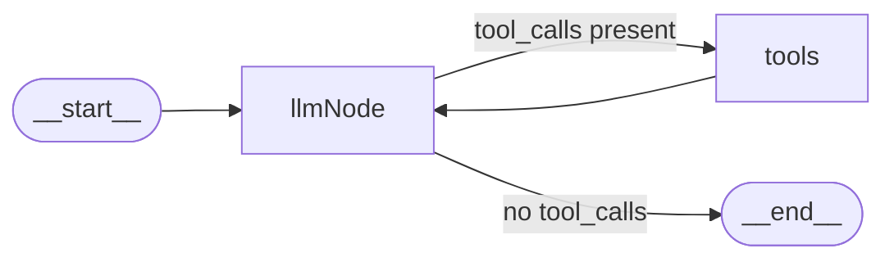

# AI Agent Architecture

BookMyDoctor includes an **agentic AI appointment assistant** that lets patients book, view, and cancel doctor appointments through natural language chat. The agent uses a **ReAct-style loop** (Reason → Act → Observe) implemented with **LangGraph** and **Grok (xAI)**.

---

## High-Level Overview

```
┌─────────────────┐     POST /api/chat/message      ┌──────────────────┐
│  React Client   │ ──────────────────────────────► │  chatController  │
│  (ChatWidget)   │ ◄────────────────────────────── │                  │
└─────────────────┘     { reply }                   └────────┬─────────┘
                                                             │
                                                             ▼
                                                    ┌──────────────────┐
                                                    │   runAIGraph()   │
                                                    │   (LangGraph)    │
                                                    └────────┬─────────┘
                                                             │
                              ┌──────────────────────────────┼──────────────────────────────┐
                              ▼                              ▼                              ▼
                       ┌────────────┐                 ┌────────────┐                 ┌────────────┐
                       │  llmNode   │ ◄────────────── │   tools    │ ──────────────► │  MongoDB   │
                       │ Grok +     │   tool results  │  ToolNode  │   read/write    │ appointments│
                       │ bindTools  │                 │ (5 tools)  │                 │ doctors/chat│
                       └────────────┘                 └────────────┘                 └────────────┘
```

The LLM decides **when** to call tools. Tools execute real backend logic (same services used by the REST API), so the database remains the single source of truth.

---

## Agent Pattern: ReAct via LangGraph

The graph is a minimal two-node loop defined in `server/services/ai/graph.js`:

| Node | Role |
|------|------|
| `llmNode` | Sends conversation + system prompt to Grok with tool definitions bound via `bindTools()` |
| `tools` | LangGraph `ToolNode` executes whichever tools the LLM requested |

**Routing logic (`shouldContinue`):**

1. If the last LLM message contains `tool_calls` → route to `tools`
2. Otherwise → end and return the final text reply to the user

This repeats until the model produces a user-facing answer without further tool calls (classic agent loop).



---

## LLM Layer

**File:** `server/services/ai/llm.js`

| Setting | Value |
|---------|-------|
| Provider | xAI (Grok) via `@langchain/xai` |
| Wrapper | `ChatXAI` |
| Model | `grok-2-latest` (override with `GROK_MODEL`) |
| Temperature | `0.3` (lower variance for booking accuracy) |
| Auth | `XAI_API_KEY` environment variable |

---

## Tool Catalog

Tools are LangChain `tool()` definitions with **Zod schemas** for structured arguments. They call existing service layers — not ad-hoc DB access from the agent.

| Tool | Purpose | Backend service |
|------|---------|-----------------|
| `get_doctors` | Search doctors by speciality | `doctorService.getDoctorsList()` |
| `get_doctor_availability` | List booked slots for a doctor | `doctorService.getDoctorAvailability()` |
| `book_appointment` | Create a booking for the logged-in user | `bookingService.createAppointment()` |
| `get_my_appointments` | List user's appointments | `bookingService.getUserAppointments()` |
| `cancel_appointment` | Cancel by appointment ID | `bookingService.cancelUserAppointment()` |

**Auth context:** `userId` is injected via LangGraph `configurable` at invoke time so tools never trust LLM-provided user IDs.

```js
compiledGraph.invoke(
  { messages: langchainMessages },
  { configurable: { userId } }
);
```

---

## System Prompt & Slot-Filling Strategy

The system prompt (built per request in `runAIGraph`) includes:

- Patient name and email
- Current date/time (for resolving "tomorrow", "next Monday", etc.)
- **Slot-filling rules:** `docId`, `slotDate` (DD_MM_YYYY), `slotTime` must be known before booking
- **Tool usage order:** find doctor → check availability → book

The agent is instructed **not to guess** missing booking parameters and to check availability before suggesting times.

---

## Data Flow: Single Source of Truth

Slot availability is derived from the **appointments collection**, not a stale cache on doctor documents.

| Concern | Implementation |
|---------|----------------|
| Booked slots | `getBookedSlotsForDoctor()` queries active (`cancelled: false`) appointments |
| Double-booking (doctor) | Unique index on `{ docId, slotDate, slotTime }` |
| Double-booking (patient) | Unique index on `{ userId, slotDate, slotTime }` |
| Time normalization | Mongoose `set` on `slotTime` normalizes formats like `2 pm` → `02:00 PM` |

This ensures the AI agent, REST API, and frontend all reflect the same live data.

---

## Persistence & Context Window

| Collection | Purpose |
|------------|---------|
| `chat` | One document per user; stores full message history |
| `appointment` | Bookings created by agent or UI |
| `user` / `doctor` | Profile data for context and validation |

**Context limit:** Only the **last 10 messages** are passed to LangGraph per request to control token cost and latency. Full history remains stored in MongoDB for the UI.

---

## API Endpoints

| Method | Route | Auth | Description |
|--------|-------|------|-------------|
| `POST` | `/api/chat/message` | JWT (`authUser`) | Send user message; receive AI reply |
| `GET` | `/api/chat/history` | JWT (`authUser`) | Load persisted chat history |

---

## Frontend Integration

**Component:** `client/src/components/Chat/ChatWidget.jsx`

- Floating chat button on the patient app (`App.jsx`)
- Loads history on mount when authenticated
- Optimistic UI: user message appears immediately; typing indicator while agent runs
- Requires login for booking actions (prompts user to sign in otherwise)

---

## File Structure

```
server/
├── controllers/
│   └── chatController.js       # HTTP layer, history persistence
├── routes/
│   └── chatRoute.js
├── models/
│   └── chatModel.js
└── services/
    ├── ai/
    │   ├── graph.js            # LangGraph workflow
    │   ├── llm.js              # Grok client
    │   └── tools/
    │       ├── index.js
    │       ├── doctorTools.js
    │       └── appointmentTools.js
    ├── bookingService.js       # Shared booking logic
    └── doctorService.js        # Shared doctor/availability logic

client/src/components/Chat/
├── ChatWidget.jsx
├── ChatWindow.jsx
└── ChatMessage.jsx
```

---

## Environment Variables

Add to `server/.env`:

```env
XAI_API_KEY=your_xai_api_key
GROK_MODEL=grok-2-latest   # optional
```

---

## Example Agent Trace

**User:** "Book appointment tomorrow at 2 pm for dermat doctor"

| Step | Action |
|------|--------|
| 1 | LLM calls `get_doctors` with `speciality: "Dermatologist"` |
| 2 | LLM calls `get_doctor_availability` for selected doctor |
| 3 | LLM calls `book_appointment` with resolved date/time |
| 4 | LLM returns confirmation with appointment ID |

**User:** "Book another for gynac at 2 pm"

| Step | Action |
|------|--------|
| 1 | `book_appointment` fails — user already has appointment at same date/time |
| 2 | LLM explains conflict and suggests alternate times |

---

## Design Decisions

| Decision | Rationale |
|----------|-----------|
| LangGraph over raw OpenAI-style loops | Explicit graph, easy to extend with more nodes (e.g. validation, human-in-the-loop) |
| Tools wrap existing services | No duplicate business logic; agent and UI stay consistent |
| Low temperature | Reduces hallucinated doctor IDs or dates |
| Zod tool schemas | Structured, validated tool arguments from the LLM |
| Appointments as source of truth | Prevents stale availability after manual DB changes or cancellations |

---

## Possible Extensions

- Streaming responses (SSE) for token-by-token UI updates
- RAG over doctor FAQs or clinic policies
- Multi-turn confirmation before destructive actions (cancel)
- Observability: LangSmith / custom tracing per tool call
- Rate limiting and cost caps per user
